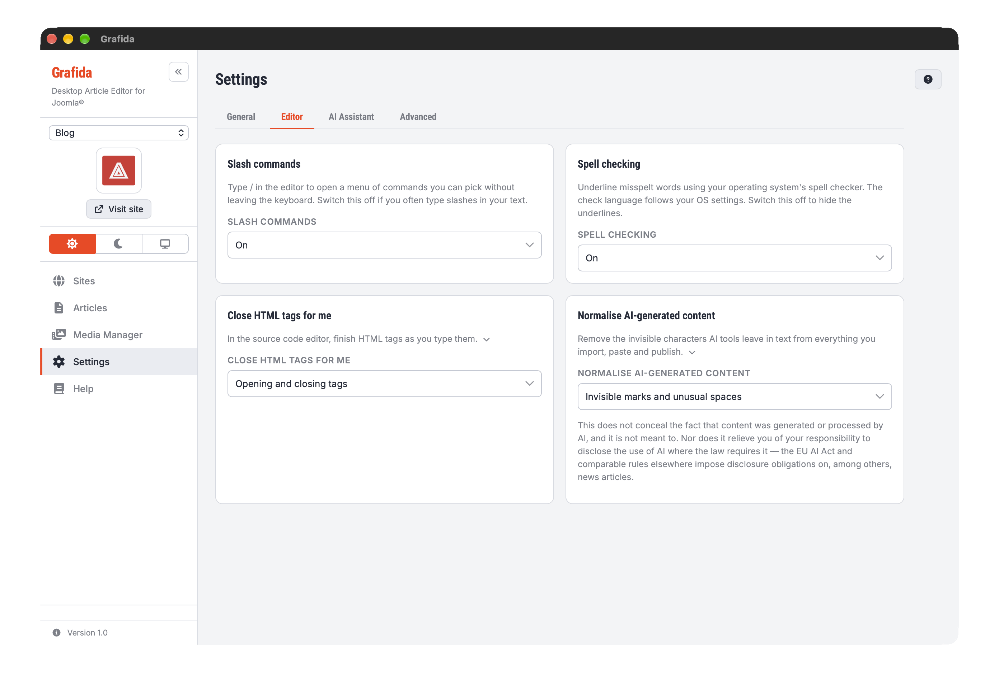
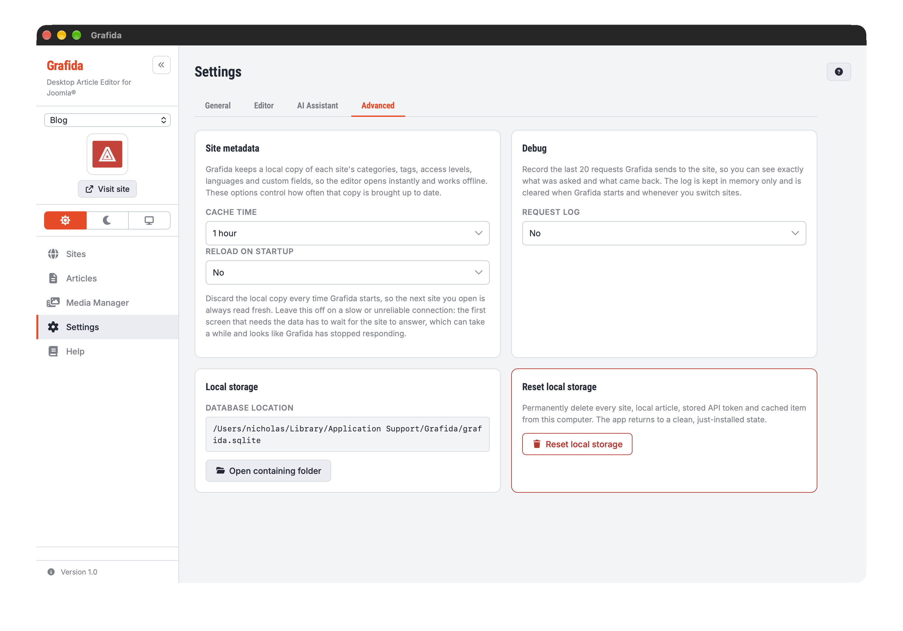

# Settings

The Settings view holds everything that applies to Grafida as a whole, rather than to one site or
one article. Settings are saved the moment you change them; there is no Save button on this page
except where one is explicitly shown.

The settings are grouped into four tabs:

- **General** — [Interface language](#interface-language) and [Display mode](#display-mode).
- **Editor** — [Slash commands](#slash-commands), [Spell checking](#spell-checking),
  [Close HTML tags for me](#close-html-tags-for-me) and
  [Normalise AI-generated content](#normalise-ai-generated-content).
- **AI Assistant** — [AI Services and AI Tools](#ai-services-and-ai-tools).
- **Advanced** — [Site metadata](#site-metadata), [Debug](#debug), [Local storage](#local-storage)
  and [Reset local storage](#reset-local-storage).

Grafida remembers the tab you were on until you quit, so leaving Settings and coming back returns
you to it.

> [!TIP]
> You can reach Settings from anywhere in the application with <kbd>Ctrl</kbd> + <kbd>,</kbd>
> (Windows, Linux) or <kbd>Cmd</kbd> + <kbd>,</kbd> (macOS).

## Interface language

The language Grafida's own interface is written in. **(Auto-detect)** follows your operating
system, falling back to English (United Kingdom) when Grafida has no translation for it.

The editor's menus and dialogs follow this setting too, where a translation exists for them.

Grafida ships English (United Kingdom), Greek, French, German, Spanish, Italian and Portuguese
(Portugal). If yours is missing, or a wording is wrong, see [Translation](Translation) — adding a
language needs no code change.

This has nothing to do with the language of the articles you write, which is set per article in the
[editor's properties sidebar](Editing-Articles#article-properties), nor with the spell-check
dictionary, which is an operating-system setting.

> [!NOTE]
> This documentation is in English only. The app and the Grafida.app Documentation section share
> the same English source.

## Display mode

**Light**, **Dark**, or **Follow system**.

The same three choices are available from the switch in the sidebar, so you can change the theme
without leaving an open article. See [Navigation](Navigation#colour-scheme-controls) for what
happens to the editor's own content area, which your site's `editor.css` may override.

## Slash commands

Whether typing `/` in the editor opens the command menu. **On** by default. Switch it off if you
often type slashes in ordinary prose.

Changing this takes effect immediately, even in an editor you already have open.

## Spell checking

Whether misspelt words are underlined in the editor, using your operating system's own spell
checker. **On** by default.

> [!IMPORTANT]
> The dictionary and the language it checks against are operating-system settings that Grafida
> cannot override. See [Editing Articles](Editing-Articles#spell-checking).

Switching it off hides the underlines straight away. Switching it back **on** only marks text you
edit afterwards, not the text already on screen — an inherent limitation of the web view Grafida
draws itself with.

## Close HTML tags for me

How the [source code editor](Editing-Articles#the-source-code-editor) helps you finish HTML tags.
There are three choices rather than a simple on/off switch, because the two halves of the feature
are genuinely useful apart from each other.

**Opening and closing tags** (the default) inserts `
` the moment you finish typing `
`.

**Closing tags only** inserts nothing on its own, but completes a closing tag once you have typed
its `</`. This is the setting for editing existing markup, where tags appearing unbidden get in the
way.

**Off** leaves you to type everything.

The setting is read when the source code editor opens, so it takes effect the next time you open
it.

## Normalise AI-generated content

Text written or rewritten by an AI almost always carries characters you cannot see. Zero-width
spaces and joiners, left-to-right and right-to-left marks, the Unicode *tag* characters — which can
spell out a whole hidden message one code point at a time — variation selectors, soft hyphens and
several kinds of unusual space. Some of it is a deliberate watermark. Some of it is simply picked
up by copying out of a web page, which does the same thing by accident.

It is worth removing for reasons that have nothing to do with watermarks:

- A screen reader announces what it finds. Invisible characters are read out, or break a word into
  two, and the article stops making sense to the person listening to it.
- A directional override can reverse the reading order of part of a sentence, showing a reader
  something different from what you wrote.
- A soft hyphen or a zero-width space inside a word breaks find-in-page and site search for
  everybody, because the word no longer matches itself.

Grafida strips these characters at every point where text crosses into, or out of, an article:

- replies from the [AI assistant](AI-Overview), as they are inserted;
- [Markdown you import](Editing-Articles);
- text pasted with **Paste as plain text**;
- the title, body and metadata of every article you **publish**.

Your local article is left alone as you work — the clean-up happens on the way out, so what reaches
your site is clean whether the text came from Grafida's AI assistant, from an ordinary paste out of
some other AI tool, or from an article you imported from the site itself.

**Invisible marks and unusual spaces** (the default) also collapses no-break, thin, hair,
ideographic and similar spaces to an ordinary space.

**Invisible marks only** leaves every space exactly as you typed it. Choose this if your typography
needs those spaces: French punctuation is set with a no-break space before `!`, `?`, `:` and `;`,
and Japanese and Chinese text is written with the ideographic space. Neither is a watermark.

**Off** touches nothing. This is also the honest choice if you write right-to-left text and place
directional marks deliberately, because Grafida treats those marks as watermark carriers and
removes them.

Characters that carry meaning are always kept, in every mode. The joiners that hold an emoji
sequence together (👨‍👩‍👧 is three people and two invisible joiners), the tag characters that spell out
a subdivision flag, and the joiners that Persian, Arabic and the Indic scripts need to shape their
letters correctly are all left where they are.

> [!IMPORTANT]
> This does **not** conceal the fact that content was generated or processed by AI, and it is not
> meant to. Removing a watermark does not make text human-written, and there are many other ways
> the origin of a text can be established.
>
> Nor does it relieve you of your responsibility to **disclose** the use of AI where the law
> requires it. The EU AI Act, and comparable rules in other jurisdictions, impose transparency and
> labelling obligations on AI-generated or AI-manipulated content — news articles published in the
> European Union being one prominent case. Editorial codes of practice frequently require the same.
> Complying with them is your responsibility, and no software setting can discharge it for you.

## Site metadata

Grafida keeps a local copy of each site's categories, tags, access levels, languages and custom
fields. That copy is what the editor and the [Articles](Articles) filters are drawn from, which is
why the editor opens instantly and works off-line. These two options control how often it is
brought up to date.

**Cache time** is how old the copy may get before Grafida quietly refreshes it in the background,
from 15 minutes to a day. **Never refresh automatically** switches the background refresh off
entirely — the **Reload metadata** buttons on the Sites, Articles and editor screens still work.

**Reload on startup** discards the local copy every time Grafida starts, so the first site you open
is read fresh from the server. It is **off** by default and should stay that way on a slow or
unreliable connection: the first screen that needs the data has to wait for your site to answer,
which looks a great deal like Grafida has stopped responding.

## Debug

**Request log** records the last 20 requests Grafida sends to your site, so you can see exactly
what was asked and what came back. It is **off** by default.

Switching it on adds a **Request Log** item to the sidebar. See [Request Log](Request-Log).

The log is kept in memory only: it is cleared when Grafida starts, whenever you switch sites, and
whenever you switch this setting off.

## Local storage

Shows where Grafida's database file lives on your computer — everything you have: sites, local
articles, unpublished pictures, cached site metadata and saved AI chats. **Open folder** opens its
containing folder in your file manager.

The file is worth including in your backups.

> [!NOTE]
> Your API tokens are **not** in that file. They are held in your operating system's own secret
> store — the macOS Keychain, the Linux Secret Service, or Windows DPAPI. See
> [Secrets security](Secrets-Security) for what that means if the file is ever exfiltrated.

## Reset local storage

**Reset local storage** permanently deletes every site, local article, stored API token and cached
item from this computer, returning Grafida to a clean, just-installed state.

> [!CAUTION]
> This cannot be undone, and there is no partial version of it. Anything you have not published is
> gone. Export the local articles you care about first —
> see [Editing Articles](Editing-Articles#moving-an-article-between-computers).

## AI Services and AI Tools

The **AI Assistant** tab configures the optional AI assistant, which is off until you set one up. They
have their own pages: [Overview](AI-Overview), [AI Services](AI-Services), [AI Tools](AI-Tools) and
[Chat](AI-Chat).
